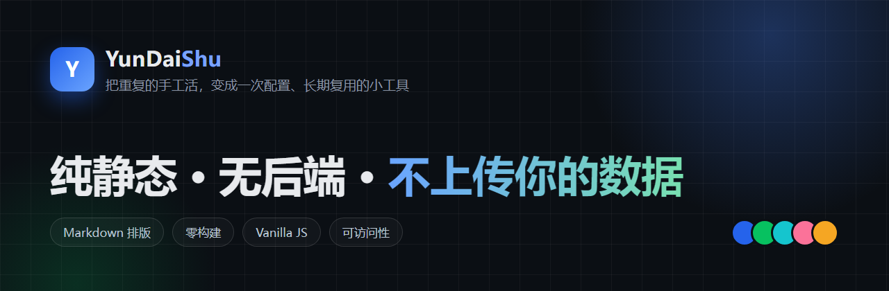

  

&nbsp;
&nbsp;

<h3 align="center">把写作和排版拆开：写一次 Markdown，发到每个平台都好看</h3>

<b>不做账号 · 不做云同步 · 不上传你的内容 · 不使用 AI</b>

---

## 现在手上在做的事

### [MkDownPost · 码稿](https://yundaishu.github.io/MkDownPost/)

面向公众号 / 小黑盒 / TapTap / 知乎创作者的 Markdown 写作与排版工作台。

| 维度 | 现状 |
| --- | --- |
| 主题 | **100 套**（8 套手调 + 92 套生成），23 个颜色令牌，明暗双色 |
| 平台适配 | **9 个**：公众号 / 小黑盒 / TapTap / 知乎 / 掘金 / CSDN / B站专栏 / 简书 / GitHub |
| 导出 | **8 种**：.md / 内联 HTML / Word / PDF / PNG / 打印×2 / 平台适配 |
| 内容 | **81 篇**写作方法文章，另有 81 个可被搜索引擎收录的静态页 |
| 工程 | 零构建、无 node_modules、无后端、GitHub Pages 托管 |
| 性能 | 首屏内联关键 CSS，路由预取，Service Worker 离线可用 |

  <a href="https://yundaishu.github.io/MkDownPost/"><b>→ 在线试用</b></a> &nbsp;·&nbsp;
  <a href="https://yundaishu.github.io/MkDownPost/#/articles">文章列表</a> &nbsp;·&nbsp;
  <a href="https://yundaishu.github.io/MkDownPost/feed.xml">RSS</a> &nbsp;·&nbsp;
  <a href="https://github.com/YunDaiShu/MkDownPost/releases">Release v1.0.0</a>

---

## 我做事的四条原则

> **数据在用户手里** — 不做账号、不做云同步，草稿只存本机 localStorage。
>
> **能用纯静态就别上后端** — GitHub Pages 足够时，就不引服务器。
>
> **依赖本地化** — 第三方库全部 vendor 进仓库，运行时不请求外部 CDN。
>
> **承认边界** — 做不到的事写进 README，而不是含糊带过。

---

## 技术栈

  <code>Vanilla JS (ESM)</code> <code>CSS 令牌系统</code> <code>Hash 路由</code>
  <code>marked</code> <code>highlight.js</code> <code>KaTeX</code> <code>Mermaid</code>
  <code>Service Worker</code> <code>GitHub Actions</code>

  
<b>关于我（点开看）</b>

  - 关注方向：Markdown 排版系统、静态站点、零构建工程、可访问性
  - 习惯：先跑起来，再优化；能删的代码就删
  - 不擅长：把简单的事讲复杂
  - 联系：在项目仓库开 [Issue](https://github.com/YunDaiShu/MkDownPost/issues) 是最快的方式

  
<b>这个主页是怎么做的</b>

  头图是 1280×420 的 PNG，用 HTML + CSS 手绘后截图生成；三枚徽章是自托管 SVG，不依赖 shields.io；
  所有资源都在本仓库 assets/ 下，GitHub 直出，不经过第三方服务。

---

如果你也在做写作工具，欢迎来 Issue 里聊聊。

